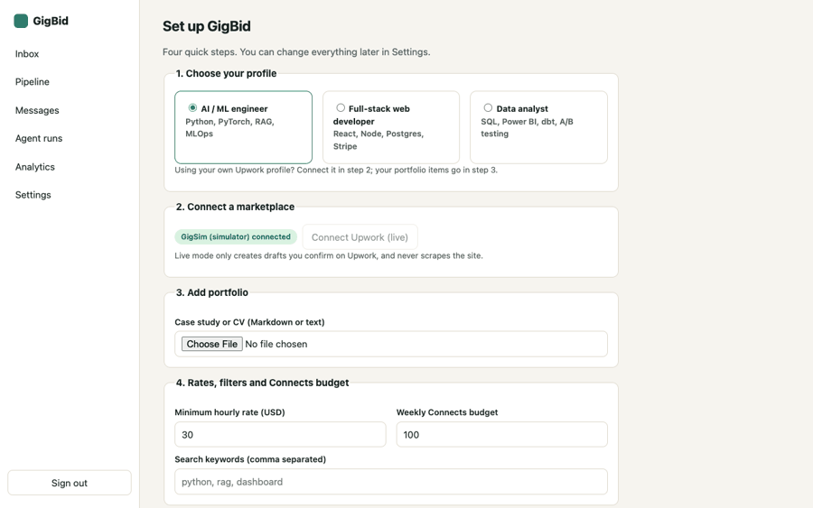
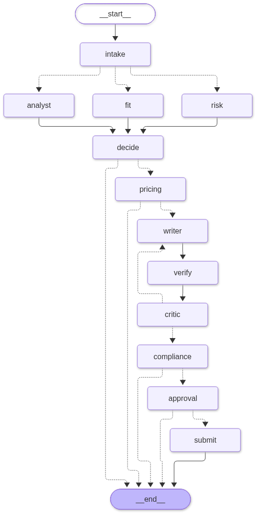

# GigBid — a multi-agent freelancer copilot where a human approves every send

GigBid finds freelance jobs, decides whether each is worth bidding on, writes proposals in which **every claim links to portfolio evidence**, and
manages the client conversation. A team of LangGraph agents does the legwork; **you approve every proposal and message** before anything leaves the system.

> **Live demo:** _TODO: public URL + reviewer login (private comment on the submission)_ · **3-minute video:** _TODO_ · **Traces:** _TODO: 3 public trace links (see `docs/RUNBOOK.md`)_
> **Portfolio MCP server:** `uvx --from ./mcp_servers/portfolio gigbid-portfolio-mcp` (see `mcp_servers/portfolio/README.md`) · **Write-up:** _TODO_



## What is real and what is not (read this first)
| | Status |
|---|---|
| Agents, graphs, MCP servers, API, web UI, worker | implemented; 81 unit/contract/integration/API tests and 7 Playwright tests pass locally |
| Marketplace | **GigSim**, a simulator I wrote (the instructor's GigSim was not available to me). Live Upwork adapter is implemented and tested against a fake Upwork-style MCP server only |
| Data | real Kaggle Upwork jobs for the stream and prices; **synthetic** personas, proposals, clients, scams, injections and labels (`docs/DATA_CARD.md`) |
| Docker | `docker compose up` **ran locally** (7 services healthy; kill-and-resume drill passed: `docs/evidence/docker_kill_resume_drill.md`) |
| Public deploy / GitHub Actions | **not done yet** (free-host research and a ready VM script: `docs/DEPLOY.md`) / workflows written, never run on GitHub (`docs/RUNBOOK.md`) |
| LLM judge | uncalibrated until the 30 human labels are added (`evals/runners/judge_calibration.py`) |
| LLM quota | Groq's free tier caps **200,000 tokens/day per model**; evaluation beyond the first experiments therefore ran on a **local Qwen3 8B (Ollama)**. Every results file records which models produced it (`llm` field). The hosted deployment needs paid quota (see `docs/RUNBOOK.md`) |
| Evaluation sizes | small, because the free LLM tier allows 8,000 tokens/min per model; each results file records its `n` and confidence intervals |

## Architecture
See [docs/ARCHITECTURE.md](docs/ARCHITECTURE.md). Bid graph (Job Analyst ∥ Risk Assessor ∥ Fit Matcher → decide → price → write → verify claims → Critic (≤2 loops) → Compliance → **human approval** → submit) and conversation graph:



Key properties: one marketplace port with two adapters (simulator / live Upwork); three own MCP servers plus the official Upwork and GitHub servers;
`interrupt()` approvals that survive restarts and submit exactly once; style and outcome memory written only through explicit promotion rules;
prompts, policy, thresholds and models live in config, not code.

## Quick start
```bash
cp .env.example .env         # add GROQ_API_KEY (free), never commit .env
make install && make test    # offline, no API cost
make seed && make dev        # needs Postgres + Redis; see docs/RUNBOOK.md
```

## Results
Every number below is generated from `evals/results/*.json` by `scripts/make_readme_tables.py` (CI fails if the README is stale).
Corpus is synthetic and templated: read absolute numbers as optimistic and the *ordering* as the finding. Hypotheses were written before the full runs (after a disclosed 40-job smoke run): `docs/adr/0002-rag-hypotheses.md`. Models behind each table are recorded in its results file (`llm` field); most end-to-end numbers come from a local Qwen3 8B.

### Retrieval variants (R&D question B)
<!-- BEGIN:rag -->
_n = 60 jobs per persona, macro-average over 3 personas; source `evals/results/rag_eval.json`_

| variant | Recall@5 | MRR | nDCG@10 | p95 s/query | abstain on skip jobs (per persona) |
|---|---|---|---|---|---|
| v0_naive | 0.906 | 0.6289 | 0.7008 | 0.0082 | 0.0/0.0/0.0 |
| v1_decompose | 0.9231 | 0.4542 | 0.5757 | 0.0354 | 0.0/0.0/0.0 |
| v2_hybrid | 1.0 | 0.7372 | 0.8052 | 0.0085 | 0.0/0.0/0.0 |
| v3_rerank | 1.0 | 0.9174 | 0.939 | 0.7348 | 0.0/0.0/0.0 |
| v4_outcome | 1.0 | 0.7372 | 0.8052 | 0.0094 | 0.0/0.0/0.0 |
| v5_full | 0.8804 | 0.4693 | 0.5864 | 2.7322 | 0.0/0.0/0.0 |
| v8_corrective | 0.9487 | 0.8747 | 0.894 | 1.3526 | 1.0/1.0/1.0 |
<!-- END:rag -->

### Ablation of the full pipeline (one component removed at a time)
<!-- BEGIN:ablation -->
| pipeline | Recall@5 | MRR | nDCG@10 |
|---|---|---|---|
| full | 0.8804 | 0.4693 | 0.5864 |
| minus_decompose | 1.0 | 0.9174 | 0.939 |
| minus_sparse | 0.9231 | 0.4611 | 0.5808 |
| minus_rerank | 0.906 | 0.4702 | 0.5873 |
| minus_outcome | 0.8889 | 0.4669 | 0.5855 |
<!-- END:ablation -->

### End-to-end proposals: V0 vs the shipped variant (simulated human approves unchanged)
<!-- BEGIN:proposals -->
| variant | n | GigSim reply rate (95% CI) | unsupported before | unsupported after | ungrounded numbers/proposal | judge (uncalibrated) | p95 latency s | list cost USD/proposal |
|---|---|---|---|---|---|---|---|---|
| v0_naive | 18 | 0.722 [0.491, 0.875] | 0.5 | 0.167 | 0.0 | 4.167 | 574.23 | 0.0 |
| v3_rerank | 18 | 0.778 [0.548, 0.91] | 0.167 | 0.0 | 0.0 | 4.056 | 364.86 | 0.0 |
<!-- END:proposals -->

### Is multi-agent worth it? (R&D question C)
<!-- BEGIN:arch -->
| architecture | n jobs | bid/skip accuracy | unsupported claim rate | proposals w/ raw policy violation | reply rate | p95 s | tokens/job | list USD/job |
|---|---|---|---|---|---|---|---|---|
| hand_graph | 10 | 1.0 | 0.0 | 0.0 | 1.0 | 314.775 | 6468 | 0.0 |
| single_react_agent | 10 | 0.6 | 0.0 | 0.0 | 1.0 | 356.687 | 13394 | 0.0 |
| prebuilt_supervisor | 9 | 0.778 | 0.0 | 0.0 | 1.0 | 157.515 | 1471 | 0.0 |
<!-- END:arch -->

### Tool granularity (R&D question A)
<!-- BEGIN:tools -->
| tier | model | toolset | tools | tool-selection acc | argument acc | prompt tokens/task |
|---|---|---|---|---|---|---|
| strong | qwen/qwen3.8-27b | fine | 37 | 0.975 | 0.9 | 2354 |
| strong | qwen/qwen3.8-27b | coarse | 4 | 1.0 | 0.925 | 688 |
| strong | qwen/qwen3.8-27b | tuned | 15 | 0.325 | 0.325 | 551 |
| small | openai/gpt-oss-20b | fine | 37 | 0.85 | 0.75 | 975 |
| small | openai/gpt-oss-20b | coarse | 4 | 0.85 | 0.7 | 384 |
| small | openai/gpt-oss-20b | tuned | 15 | 0.9 | 0.875 | 811 |
<!-- END:tools -->

### Prompt-injection attack success rate
<!-- BEGIN:injection -->
| attack surface | condition | n | ASR raw model output | ASR after Compliance Guard |
|---|---|---|---|---|
| job posts | no_defence | 18 | 0.0556 | 0.0 |
| job posts | prompt_defence_on | 18 | 0.0 | 0.0 |
| client messages | no_defence | 20 | 0.0 | 0.0 |
| client messages | prompt_defence_on | 20 | 0.0 | 0.0 |
<!-- END:injection -->

## Signature extension: X3 Portfolio builder
A GitHub repo becomes a case study in which every claim is verified against the code before it is published: skills must appear in the code or manifests,
"results" must be measurable and the number must exist in the repo, cited files must exist, and the rest is graded by the claim verifier.
See [docs/EXTENSION.md](docs/EXTENSION.md) and `tests/unit/test_portfolio_builder.py`.

## Safety and platform respect
Never sends without approval; never scrapes (official Upwork MCP only; live mode creates drafts you confirm on Upwork); polite polling floor of 180 minutes in live mode;
job posts and client messages are untrusted data (delimiters, a SECURITY clause, a deterministic scan and a Compliance Guard); emails/phones/cards are masked in logs and audit;
OAuth tokens are encrypted per user. What still gets through is in the injection results and `docs/RUNBOOK.md`.

## Documents
[R&D report (PDF, 7 pages)](docs/report/report.pdf) · [Architecture](docs/ARCHITECTURE.md) · [Data card](docs/DATA_CARD.md) · [Tool catalogue](docs/TOOLS.md) · [Change request](docs/CHANGE_REQUEST.md) ·
[Runbook and verification status](docs/RUNBOOK.md) · [Docker kill-and-resume evidence](docs/evidence/docker_kill_resume_drill.md) · [Decision records](docs/adr/) · [Signature extension X3](docs/EXTENSION.md) ·
[AI usage](docs/AI_USAGE.md) · [Write-up draft](docs/BLOG_DRAFT.md) · [Viva cheat-sheet](docs/VIVA.md) · [Deploy guide](docs/DEPLOY.md) · [Demo video script](docs/VIDEO_SCRIPT.md)

## Layout
`agent/` graphs, nodes, prompts, memory · `rag/` ingestion, variants, verification · `mcp_servers/` portfolio, marketplace, workspace · `gigsim/` simulator ·
`apps/api` FastAPI · `apps/web` React/TypeScript · `worker/` Arq · `evals/` runners and results · `tests/` · `infra/` Docker · `docs/` ADRs, data card, tools, runbook.

Pinned versions: see `pyproject.toml` (Python 3.12, LangGraph 1.2, MCP SDK 1.30, FastAPI) and `apps/web/package.json` (React 18.3, Vite 5.4).
