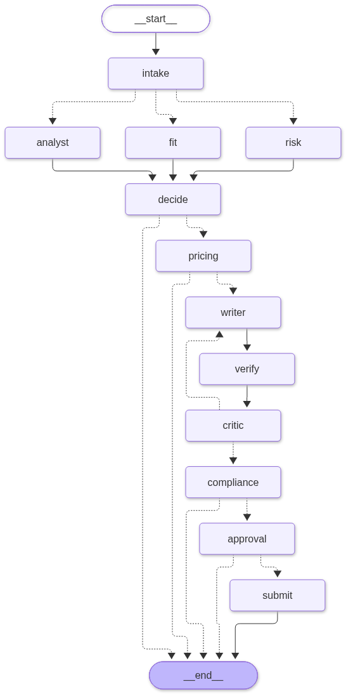
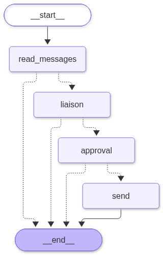

# Architecture

    (rendered from code by `scripts/render_graphs.py`)

```
 Browser (React/TS) --SSE/REST--> FastAPI ----enqueue----> Redis --> Arq worker
                                     |  \                              |
                                     |   +--- Postgres: users, runs, saved searches, encrypted tokens,
                                     |        LangGraph checkpoints (durable approvals), LangGraph store (memory)
                                     v                                 v
                              LangGraph bid graph / conversation graph  (same code in API and worker)
                                     | MultiServerMCPClient, per-agent tool allowlists, timeouts, backoff
              +----------------------+------------------------+
              v                      v                        v
     Portfolio MCP (stdio)   Marketplace MCP (HTTP+bearer)   Workspace MCP (stdio)
      read-only RAG tools      read+write, idempotency,        slots, tentative holds,
                               dry_run, rate limit, audit      email drafts (never sent)
                                     | MarketplacePort (one interface)
                         +-----------+-----------+
                         v                       v
                  GigSim adapter          Upwork live adapter -> official Upwork MCP (OAuth 2.1)
```

## Why each agent exists
| Agent | Why it is a separate step | Model tier |
|---|---|---|
| Scout | cheap, scheduled, de-duplicates before any LLM cost is spent | none / small |
| Job Analyst | turns free text into a typed `JobSpec` everything else depends on | small |
| Risk Assessor | independent verdict on scams/injection; deterministic policy rules first, small LLM second opinion | small |
| Fit Matcher | requirement -> evidence matrix; no LLM, so it cannot flatter the freelancer | none |
| Pricing Strategist | market stats + user floor + whether Connects are worth it; numeric, so deterministic | none |
| Proposal Writer | the only creative step; gets the strongest model | strong (gpt-oss-120b) |
| Claim Verifier | splits the draft into claims and grades each against evidence; unsupported claims are removed before the Critic | small |
| Critic | different model family from the Writer (no self-review); bounded to 2 revisions | mid (Qwen 27B) |
| Compliance Guard | deterministic policy pack; the last line of defence and it re-checks every human edit | none |
| Client Liaison | classifies replies and drafts answers/slots; messages are untrusted data | mid |

Job Analyst, Risk Assessor and Fit Matcher run in parallel (LangGraph `Send`). Merging agents is possible (the report shows what the
single-agent baseline gains/loses, `evals/results/arch_compare.json`); they are kept apart because the decision-relevant ones (risk, fit,
price, compliance) are deterministic and testable on their own.

## State, trace, memory (kept apart)
* **State** (`agent/state.py`): what this job needs now; reducers on `steps`, `tokens`, `cost_usd`, `critiques`, `trace`, `errors`.
* **Trace**: per-node latency/tokens/cost in the state's `trace` for the UI, plus OpenTelemetry spans to Phoenix (`agent/tracing.py`) and the MCP audit log, all sharing one `gigbid.trace_id`.
* **Long-term memory** (`agent/memory/`): style rules and outcome statistics, written **only** by `promotion_rules.py`
  (style: the same edit pattern >= 3 times across >= 2 jobs; outcome: >= 5 outcomes per category). Raw tool output never enters memory.
  The UI memory viewer lists and deletes items.

## Guarantees and where they are enforced
| Guarantee | Mechanism | Test |
|---|---|---|
| Nothing is sent without a human | `interrupt()` in `approval`; `submit` only runs after status `approved` | `tests/integration/test_bid_graph.py` (reject sends nothing) |
| Exactly-once submit | idempotency keys derived from the thread id; atomic `awaiting_approval -> resuming` claim | `test_approve_submits_exactly_once...`, `tests/api` (double approve = one 200, one 409) |
| Survives restart | durable checkpointer (Postgres / SQLite); approvals are read back from the checkpoint | `test_resume_after_crash_uses_persisted_checkpoint` |
| No fabricated claims | Fit matrix -> evidence-only Writer prompt -> Verifier removes unsupported claims -> Critic | `evals/results/proposal_eval.json` |
| Injection | untrusted delimiters + SECURITY clause + deterministic scan + Compliance Guard | `evals/results/injection_eval.json` |
| Tenant isolation | every query scoped by `user_id`; per-user marketplace identity | `test_tenant_isolation` |
| Degraded mode | bounded retries -> `MarketplaceUnavailable` -> run parked as `waiting_marketplace`, UI banner, cron resumes | `tests/unit/test_mcp_client.py`, Playwright degraded test |
| Rules not hard-coded | thresholds, budgets, models, policy in `agent/config.yaml`, `data/policy_pack/policy_rules.yaml`, `gigsim/rules.yaml`; prompts in `agent/prompts/` | `scripts/check_prompts.py` |

Decision records: `docs/adr/`.
